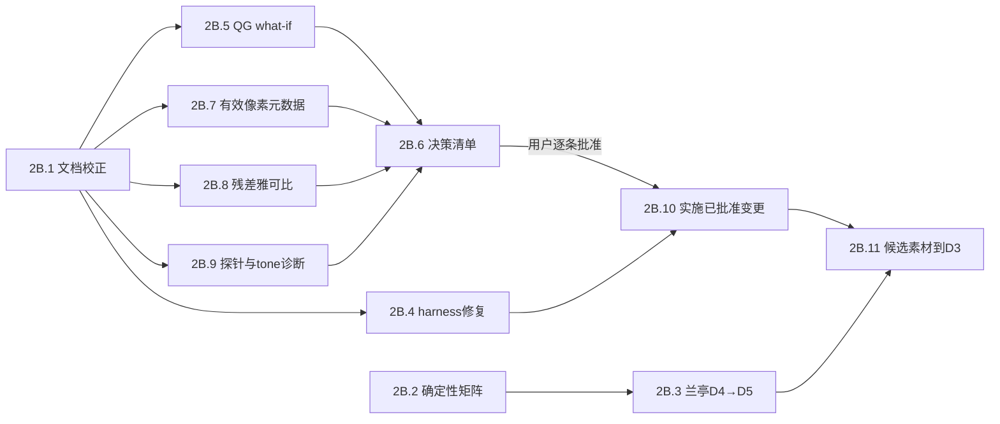

# 书画多机位翻拍：产品分析、缺陷与开发任务

**书画堆栈的开发入口。** 先看 §1–§3 了解产品现状和问题，再按 §4 领任务；§6 起是规则和参考。其他类型的任务不在本文件：

| 类别                                      | 文件                                                         |
| ----------------------------------------- | ------------------------------------------------------------ |
| 总入口：整体状态、验收证据、文档导航      | [project-progress.md](../../../docs/project-progress.md)     |
| 工程、代码结构、打包发布（ENG、原N0–N2）  | [engineering.md](../../../docs/tasks/engineering.md)         |
| 分区亮度与接缝诊断（BR）                  | [brightness-seam.md](../../../docs/tasks/brightness-seam.md) |
| 渲染、内存与色彩（RM、CL）                | [render-color.md](../../../docs/tasks/render-color.md)       |
| 堆栈旧条目（原PF、N3–N9）的完整说明，只读 | [stack-history.md](../../../docs/tasks/stack-history.md)     |

技术合同在本目录 [requirements.md](requirements.md) 与 [design.md](design.md)。原《书画推进计划》已并入本文件并归档为 [artwork-stack-plan-2026-11-12](../../../docs/archive/artwork-stack-plan-2026-11-12.md)。

**怎么用**：一项任务交给一个 agent 一次完成，brief 按 §8 模板写。开始前检查：依赖已勾选；“冲突”里的任务没有在进行；需要的资源槽排得到（§6.1）。进行中的进展写在 lane 卡 `docs/artwork-lanes/<任务号>.md`；只有 L0（集成/守门）勾选本文件。`[x]` 表示已完成并合入 `v1`。

## 1. 产品分析

**定位（2026-11-11 用户确认）**：书画多机位翻拍专用工具。给定一幅书画的一次或多次翻拍（多机位、每机位多焦点层，可能混合焦段和相机），输出一张整幅清晰、无可见拼接块的原生分辨率成片。每个像素可追溯到源图；证据不足时明确说明哪里不足，不静默生成。固定机位微距等通用焦点堆栈只做回归保护，不追加能力。

**与开源和成熟软件比较**（详见[开源对比](../../../docs/focus-stack-open-source-comparison.md) §7）：开源的焦点堆栈工具（focus-stack、ChimpStackr、ShineStacker、PlaneFuse、OpenFocus）只处理固定机位；拼接工具（Hugin、OpenCV Stitcher、ASHLAR、BigStitcher）不处理每个机位内的焦点层。“多机位 × 多焦点层 × 平面书画 × RAW × 超大画布”这个组合目前没有现成项目覆盖。

| 方面               | 我们                                                                                      | 开源最佳实践                   | 判断                           |
| ------------------ | ----------------------------------------------------------------------------------------- | ------------------------------ | ------------------------------ |
| 来源追溯与证据门禁 | 每个像素有 owner/Coverage/alpha 和 Stack_Report；无可验证重叠就拒绝；冻结二进制逐像素回归 | 弱                             | 领先                           |
| 书法笔画细节       | 硬 owner，不平均错位细节，避免双影                                                        | 金字塔/加权融合在残差下出双影  | 领先                           |
| 特征与配准召回     | FAST/BRIEF；阆苑 0–2 的 1,061 个探针只有 23 个通过                                        | SIFT/ECC/LightGlue/RoMa 可选   | 差距大                         |
| 边接受阈值         | 按素材逐步校准的固定阈值                                                                  | 置换检验从数据估计（ASHLAR）   | 差距中高                       |
| 接缝与色调         | 低频 tone + 证据约束 owner 增益；曝光/反光差异下接缝可见                                  | 整图多频带 + 曝光/渐晕联合优化 | 差距中高                       |
| 速度与资源         | 9 张 NEF 约 330–530 秒、9–12 GB；堆栈管线无 GPU                                           | GPU/CPU 自动选择               | 差距大（任务不同，不能直接比） |
| 交互修复与复核     | 无修图入口，无对齐复核视图                                                                | 来源锁定修图、多层输出         | 缺失                           |
| 外部基准           | 无                                                                                        | MFIF benchmark、交叉验证       | 缺失                           |

**结论**：正确性和可追溯性是我们的长处，要保持；短板集中在配准召回、接缝色调、全量规模（内存和耗时）和面向用户的复核修图。改进顺序按“先让每套真实素材到 D5，再补产品能力”。

## 2. 当前缺陷

起点基于 `base-2026-11-12` 的实测，后续任务5–17、4B/4C结果在对应行更新（2026-11-23复核；[base-p1 摘要](../../../docs/benchmarks/base-p1-codex-port.json)、[I1 摘要](../../../docs/benchmarks/i1-integration-baseline.json)）。

| #   | 缺陷                                         | 证据                                                                                                                                                                                                                                                                                                                                                                                                                                                                                                                      | 影响                                                                                                                                                                                    | 对应任务                       |
| --- | -------------------------------------------- | ------------------------------------------------------------------------------------------------------------------------------------------------------------------------------------------------------------------------------------------------------------------------------------------------------------------------------------------------------------------------------------------------------------------------------------------------------------------------------------------------------------------------- | --------------------------------------------------------------------------------------------------------------------------------------------------------------------------------------- | ------------------------------ |
| 1   | 兰亭接缝已修复并交付                         | 任务6 r2：跨owner P95 4→3、max7→6、>6处2→0；QG/严格保护和中等层通过；2026-11-23 用户复看整图+C1–C6 通过                                                                                                                                                                                                                                                                                                                                                                                                                   | 已达D5（第一套全量交付）                                                                                                                                                                | 6、2B.3（完成）、19            |
| 2   | 祁序仍未通过验收                             | 原联合0.1的owner覆盖0.889、边界失败；祁序1/2分别0.25均QG fail，2另有噪声比失败，排除与细节donor均已登记。任务11收口（2026-11-22）：DSC_3882正确factor 1.254602 clean A/B后local-scale仍6/8，boundary 3/15→4/16变差，QG fail                                                                                                                                                                                                                                                                                               | 原生全量未验收；单源factor无效                                                                                                                                                          | 11（诊断收口）、2B（C2）       |
| 3   | 枫鹰仍未通过验收                             | 原0.1尺度比/边界失败、owner证据不足、112未解析；0.25尺度比/owner失败、边界pass、未解析0，6张渲染JPEG按预期排除。任务12收口：owner fallback、resampling、DSC04916 factor均未通过；factor修复单点，但owner coverage 0.9714→0.9709并新增2个boundary失败                                                                                                                                                                                                                                                                      | 原生全量未验收                                                                                                                                                                          | 12（诊断收口）、2B（C2）       |
| 4   | 全量原生仍未验收                             | base下7次scale=0.25全量诊断（[任务5摘要](../../../docs/benchmarks/task-5-full-baseline.json)）；scale=1只有4C阆苑84张（rejected）与任务16马远2 control（diagnostic rejection）两次全量原生运行                                                                                                                                                                                                                                                                                                                            | 已能按实际阻断归组，仍不能据此交付原生成片                                                                                                                                              | 5.1–5.6、11–17、2B             |
| 5   | 阆苑全量尺度/边界仍未通过                    | 10张余量约0.012px的历史结论保留；84张0.25闭环收敛但尺度比/边界QG失败、密度保护旁路。4C scale=1 rejected：closure `unreliable`（direct P95 3.5277px）、density `invalid_native_jacobian_probes`（invalid 82）、QG local-scale两项fail。任务13收口：10个local-scale失败点residual支持区内0/外10；所需因子1.08615–1.76232，无全局倍率；offender 0↔17 support 0.42051、scale 1.17565、inliers 174<249；station17组内drift为station0的2.77×/3.81×。导出后参考配准指标失败（66匹配、内点<40）使harness exit 101，原生判定未执行 | 全量原生未验收；harness缺陷掩盖原生判定                                                                                                                                                 | 13、2B.4、2B.8、2B.9           |
| 6   | 并发负载下结果可能不同                       | I1f 的 9 张热跑与枫鹰并发时站点关系内点不同而失败，独立重跑通过。2026-11-23确认机制：需求3.5的120秒墙钟图割预算使输出随线程数和负载变化（r2：t1、t2与t5/t8不同，t2两次互不相同）。2B.12改为确定性计算量后，r3矩阵8次均为v28                                                                                                                                                                                                                                                                                               | 线程数维度已修复；并发、改名乱序、取消、OOM 仍未验证                                                                                                                                    | 2B.12（完成）、22              |
| 7   | 规模化耗时高，原生资源已测但质量未过         | 0.25阆苑84张约70.7min/14.418GiB，文苑126输入约159.3min/14.074GiB；阆苑scale=1独占试跑约163.83min/12.69GiB，84/84预检通过、未超24GiB，但harness exit101、closure/QG拒绝；重复融合仍是性能归因候选                                                                                                                                                                                                                                                                                                                          | 本轮未触发任务15硬条件；原生资源可行性与原生质量验收继续分离                                                                                                                            | 15                             |
| 8   | 固定阈值迁移性差                             | 3px、1%、相关系数 0.8/0.9 等按素材校准                                                                                                                                                                                                                                                                                                                                                                                                                                                                                    | 新素材容易误拒或误收                                                                                                                                                                    | 7                              |
| 9   | 缺少面向用户的复核与修图                     | 没有对齐复核视图、失败说明和来源锁定修图                                                                                                                                                                                                                                                                                                                                                                                                                                                                                  | 用户无法自己定位和修正问题                                                                                                                                                              | 9、20、21                      |
| 10  | 无参考图的素材只能靠人看                     | 祁序、马远2、睡觉、文苑没有参考图                                                                                                                                                                                                                                                                                                                                                                                                                                                                                         | D4 依赖用户时间                                                                                                                                                                         | §6.3 复看队列                  |
| 11  | 诊断与失败状态不统一                         | Stack_Report 诊断和最终发布状态未覆盖所有路径（原 N3.3、N7.3）                                                                                                                                                                                                                                                                                                                                                                                                                                                            | 失败难定位                                                                                                                                                                              | 储备 R1、R6                    |
| 12  | 文苑输入/色调仍有问题                        | 任务14收口：schema-8排除合同闭合，但DSC_4885物理缺失（0字节、无可恢复副本）；density两尺度均`nonidentity_world_residual` bypass；scale=1 tone max 8.778901/142处，34–39 replay 9.420790/95处；owner/source identity已核对，剩余为witness-local content/photometric mismatch                                                                                                                                                                                                                                               | 未作原生验收；scale=1唯一阻断为tone硬拒                                                                                                                                                 | 14（诊断收口）、2B（C4、2B.9） |
| 13  | 密度放大与闭环门槛冲突                       | `output_density.rs` `validate_output_closure` 把closure值乘以密度因子再与3px比较：睡觉2.5386→×1.37891→3.5005，马远2 2.6047→×1.17676→3.0651，赵佶2.768→×1.29297→3.5795。需求7.8原文单位为“世界坐标原生像素”                                                                                                                                                                                                                                                                                                                | 基础closure通过的三套素材仍被输出像素闭环拒绝                                                                                                                                           | 2B（C1、2B.10）                |
| 14  | 残差形变雅可比违反合同，被density bypass掩盖 | 任务16 residual-aware诊断合成尺度min 0.0172509 / p01 0.8607 / median 1.056，最坏station8/source18 [8097,5409]（[摘要](../../../docs/benchmarks/task-16-residual-aware-density-diagnostic-result.json)）；按需求8.3/8.4/8.9推得尺度大致不应低于0.75                                                                                                                                                                                                                                                                        | `nonidentity_world_residual` 旁路使阆苑0.25、文苑、马远2 scale=1 的密度规划不可审计                                                                                                     | 2B.8、2B（C7）                 |
| 15  | v1 HEAD 的9张输出已偏离v28，合入前未跑回归   | 二分（2026-11-23，睡觉9张scale=1、8线程）：`c9aa8950`、`01eaf132` 仍为v28 `718a903d…`，`0b6147b1` 起为 `6b7a5b26…`，约41.9%像素不同、QG仍pass；分组/融合/站点关系/闭环相同，tone与QG统计不同。`0b6147b1` 带入任务14的三条生产 owner 规则（`stale_owner_should_yield`、seam 处换到 canvas-like 一侧、`native_revisit_candidate_should_replace`），合入前没有跑中等层（最后一次是 task-6）。见[摘要](../../../docs/benchmarks/2B12-graph-cut-work-budget-control-r1.json)                                                   | 已处理（用户选a）：`72fd0df4` 只回退这三条生产规则、保留test-only诊断，本地v1快进；9张回到 `718a903d…`，中等层5/5通过（`matrix-2b13-r1-medium`）。任务14的 owner guard 需重新按§6.3提交 | 2B.13（完成）、14              |

## 3. 改进计划

**路线**：基础设施（第 0 批）→ 摸清每套素材现状并修兰亭（第 1 批）→ 按素材逐套推进到 D5（第 2 批）→ 先拿第一个 D5 并按失败类型跨素材修复（第 2B 批，2026-11-23 起；第 2 批各项均以诊断收口结束、无生产修复合入）→ 补产品能力（第 3 批）。每一批的目标：

| 批次     | 目标                                                              | 退出条件                                                   |
| -------- | ----------------------------------------------------------------- | ---------------------------------------------------------- |
| 第 0 批  | 多 agent 能安全地同时工作（一个编译、一个运行，排队，不占满机器） | 任务 1–4 完成，演练通过                                    |
| 第 1 批  | 每套素材有诊断卡；兰亭接缝回到 P95≤3；注册与阈值的离线证据        | 任务 5–9 完成                                              |
| 第 2 批  | 祁序、枫鹰、阆苑 84、文苑 126 等逐套到 D3/D4/D5                   | 至少 3 套素材 D5                                           |
| 第 2B 批 | 先拿第一个 D5；跨素材修复与 QG 合同决策                           | 兰亭 D5；决策清单经用户逐条批准；至少 2 套新 D3 入复看队列 |
| 第 3 批  | 修图、复核视图、确定性矩阵、书画几何                              | 视诊断与用户需求                                           |

**单套素材交付等级**：逐级推进，只有 D5 才算这套素材交付；任何回退都记录原因。

| 等级 | 名称             | 判据                                                                                      |
| ---- | ---------------- | ----------------------------------------------------------------------------------------- |
| D1   | 能出预览         | scale≤0.25 运行完成；每张源图要么参与，要么被明确排除并写明原因；失败时能定位到失败阶段   |
| D2   | 原生出图         | scale=1 写出 RGBA16 TIFF，来源 Coverage/owner/alpha 合同通过，`output.written` 与文件一致 |
| D3   | 门禁通过         | Quality Gate pass（足量 ROI），闭环 converged 或明确不适用；未通过项不靠改阈值消除        |
| D4   | 用户视觉确认     | 用户看过整图和关键原生裁片并确认；无参考图的素材也必须由用户确认                          |
| D5   | 可复现且资源合规 | 同一冻结二进制独立运行两次输出摘要一致；峰值 RSS 不超过资源门；回归保护已冻结             |

**资源门（本机 Apple M5，10 核，32 GiB）**：单次运行峰值 RSS ≤ 24 GiB（25,769,803,776 B），超过即判资源失败。耗时暂不设硬门槛，全量摸底后由用户给出范围。

### 3.1 基础版本与素材

- **基础版本**：`v1` 上的标签 `base-2026-11-12`（I1 + codex 移植，回归输出与 I1 逐字节相同，见 [base-p1 摘要](../../../docs/benchmarks/base-p1-codex-port.json)）。之后每次 L0 合入并冻结的版本都直接落在 `v1` 上；其他历史分支不作开发起点。
- 素材目录 `/Users/dp/Downloads/书画拼图`（只读），清单 `tests/acceptance/focus-stack-datasets.json`。

全量素材 D5 目前 1 套：兰亭（2026-11-23）。睡觉 9 张子集是回归保护用的 D5，不算全量交付。

| 数据集              | 输入         | 当前等级 / 最新证据                      | 已知情况                                                                                                                                                                                                                                             |
| ------------------- | ------------ | ---------------------------------------- | ---------------------------------------------------------------------------------------------------------------------------------------------------------------------------------------------------------------------------------------------------- |
| lanting 兰亭        | 45 JPEG      | **D5**（2026-11-23）                     | task6 r2 TIFF `29852099…`：同冻结二进制两次一致，当前v1（`bcddb6a6`）与回退版中等层仍逐字节相同；QG pass/8ROI、v4严格保护通过；峰值RSS≤12.52GiB；用户复看整图+C1–C6回复“通过”（D4）。见[D5收口](../../../docs/benchmarks/lanting-d5-closure-r1.json) |
| langyuan 阆苑女仙   | 84 NEF       | 前 10 张 D3；84 张 diagnostic rejection  | 10 张两次一致，输出 P95 距 3px 门槛约 0.012px。84 张：5.5 的 0.25（约70.7min/14.418GiB，QG fail）；4C scale=1 rejected（12.69GiB/9829.78s，closure unreliable、local-scale fail）；任务13收口                                                        |
| wenyuan 文苑图      | 126 NEF      | 前 10 张 D3；126 张 diagnostic rejection | 126 张：5.6 的 0.25（约159.3min/14.074GiB）；任务14收口，scale=1唯一阻断为tone（max 8.778901）；DSC_4885 为0字节文件、已显式排除                                                                                                                     |
| qixu 祁序（1+2）    | 75 + 98 NEF  | 0.25 能出图，QG fail                     | 祁序1/2 分别 0.25 运行（5.3），均 QG fail（local-scale、边界、owner覆盖0.91138/0.87345，祁序2另有噪声比）；任务11收口；legacy路径；两次拍摄相隔两天；无参考图                                                                                        |
| fengying 枫鹰雉鸡   | 63 + 17 + 24 | 0.25 能出图，QG fail                     | 三文件夹110输入 0.25（5.4）：尺度比/owner fail（0.97136）、边界 pass、未解析0，6张渲染JPEG排除；任务12收口；legacy路径；头部倍率约1.4倍                                                                                                              |
| mayuan-2 马远2      | 47 NEF       | diagnostic rejection                     | 5.1 的 0.25 被输出像素闭环拒绝（3.0651>3）；任务16 scale=1 control：local-scale pass、closure converged，剩余 boundary（2个可测，1个3.0px）、`effective_pixel_count` 证据不足、owner unresolved 163（5×5 stencil test-only 降到0）                   |
| sleeping 睡觉       | 45 NEF       | 9 张子集 D5；45 张 diagnostic rejection  | 9 张是全局回归保护。45 张：5.2 的 0.25 被 `output_pixel_closure_limit_exceeded` 拒绝（2.5386×1.37891=3.5005）；任务16                                                                                                                                |
| chibi 赤壁          | 48 NEF       | D1；diagnostic rejection                 | 任务17：local-scale 6/8失败、boundary 4/155失败、tone degraded max ΔE00 10.0429（2↔5）；source witness `native_source_sampling_unmapped`；不授予 native/D3                                                                                           |
| lisong 李嵩         | 46 NEF       | D1；diagnostic rejection                 | 任务17：只有 boundary fail（P95 1.7252，6个可测）；station9↔13 局部笔画内容不一致；tone max ΔE00 0.5646（D1）/0.9196（后续复核），均<1.5；density applied（factor 1.1845703125）                                                                     |
| xiagui 夏圭         | 48 NEF       | D1；diagnostic rejection                 | 任务17：boundary 7/46失败（2.4287–3.5658），station3↔9；tone 1.3807、density applied（factor 1.201171875）                                                                                                                                           |
| lidong 李东         | 25 NEF       | D1；diagnostic rejection（结构性）       | 任务17：几何3个不连通分量，桥接候选尺度1.27/1.36超范围；fallback QG也 fail；不强行桥接                                                                                                                                                               |
| zhaoji 赵佶         | 47 NEF       | D1；diagnostic rejection                 | 任务17：output-density closure 拒绝（2.768×1.29297=3.5795）；station12 Jacobian A/B 后仍拒绝，停止 factor 扫描                                                                                                                                       |
| mayuan-psd 马远 PSD | 14 PSD       | 暂缓                                     | 2026-11-12 用户决定先不做；不进入任何任务和矩阵                                                                                                                                                                                                      |

## 4. 任务清单

### 已完成

- [x] S0 / ENG.6 两条代码线集成，冻结 I1（2026-11-12）。见[I1 摘要](../../../docs/benchmarks/i1-integration-baseline.json)。
- [x] ENG.7 codex 分支评估与移植，打标签 `base-2026-11-12`（2026-11-12）。见[base-p1 摘要](../../../docs/benchmarks/base-p1-codex-port.json)。

### 第 0 批：并行基础设施（N8.5）

先完成本批，之后的任务才按 §6 的槽和目录规则运行。任务1的资源槽与冻结工具已验收，使用方式见 [stack-lab说明](../../../scripts/stack-lab/README.md)。任务2的单次运行、矩阵与内存门、任务3模板与复看队列、任务4线程预算修复与真实两槽演练均已验收。第0批基础设施任务1–4完成；4A–4C补充统一报告、输入预检、确定性矩阵和一次原生资源试跑，其中4B只完成工具，真实矩阵见2B.2。

- [x] 1. 资源槽与冻结二进制工具（2026-11-17）
  - 目标：`slot.py build|run|exclusive|status` 与 `freeze.py --label <label> [--worktree <path>] [--adopt <exe>]`，行为按 §6.1、§6.2。
  - 修改：`scripts/stack-lab/slot.py`、`freeze.py`、`common.py`。
  - 资源：`build` 槽（冻结一次）。依赖：无。冲突：无。
  - 完成标准：两个同类请求确实排队，`status` 显示占用者；上限与 `nice` 生效；用 `output/acceptance/base-p1/candidate-release-binary` 冻结出 `binaries/base-2026-11-12`，SHA 与 base-p1 一致；label 重复时拒绝。
  - 验收：17项隔离进程测试通过；真实base冻结SHA与原记录一致、原始提交及523项清单保留；真实Cargo编译/冻结、执行入口及3项定向冒烟通过。见 [任务卡](../../../docs/artwork-lanes/1-resource-freeze.md)及[机器摘要](../../../docs/benchmarks/task-1-resource-freeze.json)。此条仅验收任务1；后续状态见各条，不宣称已完成完整线程确定性演练。

- [x] 2. 单次运行与回归矩阵脚本（2026-11-17）
  - 目标：`run.py`（一次素材运行，自动排队 `run` 槽，写 `execution.json`/`analysis.json`：QG、未通过项、来源计数、峰值 RSS、内存门、wall、`contended`、TIFF SHA；兰亭取景运行附纸面审计和严格保护）和 `matrix.py --tier quick|medium|extended|full`。
  - 修改：`scripts/stack-lab/run.py`、`matrix.py`、`lanting_audit.py`，新数据文件 `tests/acceptance/regression-matrix.json`（每套素材一行预期：TIFF SHA、QG、闭环、已知失败的失败特征）。
  - 资源：`run` 槽。依赖：1。冲突：无。
  - 完成标准：对 `base-2026-11-12` 跑一遍中等层，全部与 [base-p1 摘要](../../../docs/benchmarks/base-p1-codex-port.json) 一致；故意给错一条预期时矩阵报失败并自动用 `exclusive` 重跑。
  - 验收：32项工具测试、快速层7项、中等层5/5通过；5份TIFF均与冻结基线相同，兰亭严格保护通过。独立副本故意写错SHA，两轮真实运行（run→exclusive）均保留该差异，矩阵按预期返回1。7次运行最大RSS10.371GiB≤24GiB，最终产物复核通过。见[任务卡](../../../docs/artwork-lanes/2-run-matrix.md)及[机器摘要](../../../docs/benchmarks/task-2-run-matrix.json)。此条仅验收任务2；任务3–4以各条状态为准。

- [x] 3. lane 卡与复看队列模板（2026-11-17）
  - 目标：`docs/artwork-lanes/README.md`（lane 卡模板、诊断卡模板、新素材接入步骤）和 `docs/artwork-lanes/review-queue.md`（待看 ≤3 套、按批记录）。
  - 修改：`docs/artwork-lanes/`。资源：无。依赖：无。冲突：无。
  - 完成标准：诊断卡字段覆盖 §4 任务 5 的全部输出项；复看队列能看出当前待看几套、每批包含哪些路径。
  - 验收：lane/诊断卡与新素材步骤齐全，覆盖任务5的9组输出字段；复看队列含当前表、批次和历史，跨批次待看≤3且绑定整图/原生裁片路径与版本。当前已登记0/3，不自动授予D4。17项文档核对通过；纯文档不重跑素材。见[模板说明](../../../docs/artwork-lanes/README.md)、[复看队列](../../../docs/artwork-lanes/review-queue.md)及[任务卡](../../../docs/artwork-lanes/3-templates.md)。该条仅验收任务3模板；任务4以其记录为准。

- [x] 4. 线程上限核对与两槽演练（2026-11-17）
  - 目标：确认 §6.1 的上限不改变基线，并实际演练一次“一个编译 + 一个运行 + 一个排队”。
  - 内容：9 张在 `RAYON_NUM_THREADS=5` 下运行，核对 TIFF 是否仍等于 v28；同时在 `build` 槽做一次冻结，再提交第二个运行请求验证排队；核对 `contended` 标记和输出隔离。
  - 资源：`build` + `run`。依赖：1、2。冲突：无。
  - 完成标准：结果写入 lane 卡；L0 勾选本批任务 1–4。若 TIFF 不同，记为 N8.2 缺陷，基线运行改用 `exclusive` 默认线程，并请用户决定。
  - 验收：修复独立预处理池6线程绕过Rayon=5的问题；旧冻结二进制无合同验证时强制exclusive。r2真实编译+运行+排队、nice、contended和输出隔离全部通过；两次9张的全局/预处理均5，TIFF=v28。快速层7项、Rust1095/0/44、35项工具测试、中等层5个范围均通过且TIFF保持冻结值，最大RSS11.876GiB。见[任务卡](../../../docs/artwork-lanes/4-two-slots.md)及[机器摘要](../../../docs/benchmarks/task-4-two-slots.json)。不外推N8.2完整确定性或其他全量素材。

- [x] 4A. 统一报告与输入预检（R1/R3/R6，2026-11-23）
  - 目标：运行前检查缺失、非文件和零字节源；统一记录 `accepted`、`preview_only`、`degraded`、`rejected`、`resource_failed`、`cancelled` 和 `not_run`，保留旧 `status` 与拒绝返回码。
  - 修改：`scripts/stack-lab/run.py`、`tests/stack-lab/test_runs.py`。`expectedSkipped` 中的空源只能作为显式 `input_preflight.explicit_exclusions` 记录，其他空源在 native harness 启动前拒绝。
  - 验收：schema=2 的 `execution.json`/`analysis.json` 写入输入预检、统一状态和失败原因；预检失败不生成 `run.log`、不启动 native；既有QG、阈值、fallback和拒绝语义不变。

- [x] 4B. 有界确定性矩阵（N8.2/N8.3，2026-11-23；r3 真实矩阵通过，见 2B.12）
  - 目标：在 `exclusive` 槽对冻结二进制按线程 `1,2,5,8`、每档至少两次运行，比较状态、QG、闭环、来源计数、输出元数据和输出 SHA；wall/RSS/报告路径只作资源观察，不参与确定性判定。
  - 入口：`scripts/stack-lab/determinism.py`；报告写入 `output/acceptance/<lane>/determinism-<label>/determinism.json`。`--dry-run` 只验证配置，不启动素材。
  - 验收：工具单元测试通过；矩阵明确标记尚未覆盖的改名/乱序、并发、取消、OOM 和 provider fallback，不把未运行项写成通过。sandbox 中的 r1 尝试因 required nice/setpriority 以 exit `127` 阻断，已保留 `blocked` 证据；在具备同一调度权限的环境中，r2 对已有 D5 的 `sleeping-9-6479` 完成 8 次 native，全部 driver/QG pass，但矩阵判定 determinism fail：线程1两次相同，线程2两次彼此不同，线程5/8各自重复相同但与线程1/2不同。峰值 RSS `10.07GiB`、内存门通过；不把 QG pass 当作 determinism pass，不改生产路径。见 [sleeping-9 r2矩阵](../../../output/acceptance/task-4b/determinism-sleeping9-r2-escalated/determinism.json)、[r2摘要](../../../docs/benchmarks/task-4b-sleeping9-determinism-r2.json)、[r1环境阻断](../../../docs/benchmarks/task-4b-determinism-blocked-r1.json)。
  - 2026-11-23复核：`slot.py` 的 `lower_priority()` 调 `os.setpriority` 提高 nice 值，普通进程本可这样做；r1 的 EPERM 来自 agent 沙箱（macOS Seatbelt），不是合同问题。随后在具备同一调度权限的环境完成 `determinism-sleeping9-r2-escalated`：8 次 native 均退出0且QG pass，但稳定签名输出SHA不一致，线程2还出现同线程重复漂移；4B保持未勾选，N8.2缺陷交决策。后续不再用r3重跑掩盖差异，见 2B.2。

- [x] 4C. `scale=1` 独占资源试跑（2026-11-23）
  - 目标：在4A/4B通过后，对一个无物理缺失源的84/126张素材执行一次 `exclusive` 原生运行，记录 `execution.json`、`analysis.json`、Stack_Report、输出合同、峰值RSS、wall、磁盘和确定性签名；不修改共享阈值或预期。
  - 完成标准：无论通过、资源失败还是QG拒绝，都保留完整证据并更新对应诊断卡；若超过24GiB，转任务15的tile/流式方案，不能放宽资源门。
  - 验收：阆苑84张、scale=1、exclusive、84/84输入预检通过；峰值RSS `13,631,864,832B`（12.69GiB）低于24GiB，wall `9829.78s`，产物目录约`2.9GiB`。TIFF写出与artifact validation通过，TIFF与canvas均为34670×10560。harness exit 101 来自 `focus_stack_fixture.rs:750` 对验收指标的 `.expect()`：参考图 `DSC_3762_FocusStack.jpg` 配准失败（66个descriptor匹配、内点不足40，partial-reference窗口均 `fit_inliers_below_40`），panic 发生在TIFF写出之后、`focus-stack result:` 行和原生验收判定之前；runner 因缺少 result 行把它报成“verified TIFF dimensions do not match the rendered result”，这是误报（2026-11-23更正，修复见 2B.4）。其余结论不变：closure `unreliable`（max direct-pair p95 `3.5277px`）、density 因 `invalid_native_jacobian_probes` bypass，QG fail（local-scale 两项 fail），统一状态为 `rejected`；不授予D2/D3，不改阈值、bounds、fallback或拒绝语义。证据见[阆苑scale=1试跑机器摘要](../../../docs/benchmarks/task-4c-langyuan-scale1-pilot-r1.json)与[任务13诊断卡](../../../docs/artwork-lanes/13-langyuan-diagnostic.md#scale1独占资源试跑)。

### 第 1 批：第 0 批完成后

本批任务修改区域互不重叠，但都要排队用槽。任务5本轮使用缺少共享限额验证的旧冻结基线，按任务4兼容规则全部占`exclusive`（两槽）；任务6的兰亭运行使用`run`，任务6、7、8与接缝诊断共用`build`。

- [x] 5. 全量摸底（N3.5，只跑不改代码，2026-11-18）
  - 每项一套素材，彼此独立，可由不同 agent 领取；都用 `binaries/base-2026-11-12`，scale 0.25，产出一张诊断卡（参与/排除的源图及原因、实际路径和 station 数、停止阶段、N4.5 失败链计数、峰值 RSS、wall、预览和最明显问题的位置、初步判断归哪个区域组、是否需要任务 7–8 或 15 的横向能力）。
  - 修改：只写 `docs/artwork-lanes/S2-<dataset>.md` 和 `docs/benchmarks/`。冲突：无（只排队）。
  - 验收：按同一冻结base完成7次scale=0.25全量运行，585个输入均有来源账，7张诊断卡/机器记录齐全，失败、未运行和观测缺口原样保留；输入/参考/二进制摘要保持，最大RSS15.582GiB。无生产代码、质量阈值或正式基线改动，不新增原生D2/D3或用户D4。旧基线按任务4规则均独占、Rayon≤8。见[总摘要](../../../docs/benchmarks/task-5-full-baseline.json)。
  - [x] 5.1 马远2 47 张（`exclusive`；[诊断卡](../../../docs/artwork-lanes/S2-mayuan-2.md)）
  - [x] 5.2 睡觉 45 张（`exclusive`；[诊断卡](../../../docs/artwork-lanes/S2-sleeping.md)）
  - [x] 5.3 祁序1 75 张、祁序2 98 张分别跑（均`exclusive`；[祁序1](../../../docs/artwork-lanes/S2-qixu-1.md)、[祁序2](../../../docs/artwork-lanes/S2-qixu-2.md)）
  - [x] 5.4 枫鹰三文件夹110输入（`exclusive`；与base的0.1记录按相同来源范围对照，[诊断卡](../../../docs/artwork-lanes/S2-fengying.md)）
  - [x] 5.5 阆苑84张（`exclusive`；[诊断卡](../../../docs/artwork-lanes/S2-langyuan.md)）
  - [x] 5.6 文苑126张（`exclusive`；[诊断卡](../../../docs/artwork-lanes/S2-wenyuan.md)）

- [x] 6. 兰亭纸面接缝（N6.5，流式 mosaic 组，2026-11-18）
  - 目标：纸面跨 owner 阶跃 P95 从 4 降回 ≤3，边界 >6 处数不增加，QG 仍 pass，严格保护通过；视觉变化进入复看队列。
  - 修改：`mosaic/streaming_mosaic.rs`、`streaming_illumination.rs`、`quality_gate_runner/*`。
  - 资源：`build` + `run`。依赖：1、2。冲突：任务 11、12（同区域）。
  - 验收：同位重叠图直接拟合渲染增益基，独立holdout与旧场回退、8%限幅；纸面P95 4→3、max7→6、>6处2→0，QG pass/8ROI、unresolved0，输入/owner/coverage/canvas保持。快速7组、Rust1098/0/44、最新Node19项、中等5/5均过；r2同冻结二进制两次原生TIFF相同，中等最大RSS10.726GiB。只更新本素材v4加严合同及矩阵行，其他素材/旧锐度floor/共享QG阈值不变。已本地合入；[任务卡](../../../docs/artwork-lanes/6-paper-seams.md)、[机器摘要](../../../docs/benchmarks/lanting-task-6-paper-seams.json)、[复看队列](../../../docs/artwork-lanes/review-queue.md)R20261118-1待看1/3，仍D3，不自授D4/D5。

- [x] 7. 置换检验离线实验（PF.8，2026-11-18）
  - 目标：用已保存的匹配点和代理图，统计随机不相邻机位对能达到的相似度分布，与现有固定门槛对照，看能否识别重复题字/人物造成的假边；阆苑 0–2 为第一条测试边。只写 test-only 代码和报告，不改生产路径。
  - 修改：注册实验区域（新测试模块）、`docs/`。资源：少量 `build`。依赖：1。冲突：无。
  - 验收：阆苑84张只读代理/保存匹配点完成1000次确定置换，真实跨组边76条；随机NCC P99=0.976218，真实边39/76高于；0–2原生64 inliers/1.260px与代理NCC不在同一统计域。仅test-only，未改生产路径、Stack_Report、阈值或素材基线。见[任务卡](../../../docs/artwork-lanes/7-permutation.md)及[机器摘要](../../../docs/benchmarks/langyuan-task-7-permutation.json)。

- [ ] 8. 注册 provider 离线对照（PF.10 注册部分）
  - 目标：FAST/BRIEF、SIFT 或 AKAZE、ECC 精修、LightGlue+DISK/ALIKED（ONNX）对照，指标见[开源对比 §10.2](../../../docs/focus-stack-open-source-comparison.md)；provider 只提交候选，最终门禁不变；不用 SuperPoint 权重和 MASt3R。
  - 修改：注册实验区域中与任务 7 不同的文件、`docs/`。资源：少量 `build`。依赖：1。冲突：无。
  - 2026-11-19延期：provider边界、fallback和能力审计完成，OpenCV与RaCo-ALIKED-LightGlue候选均已运行；learned descriptors→Rust adapter/geometry gate 仍阻断，未写入 pose、Stack_Report 或 QG。见 [任务卡](../../../docs/artwork-lanes/8-provider-audit.md) 与 [延期决策](../../../docs/benchmarks/task-8-final-decision-r1.json)。

- [x] 9. 来源锁定修图设计（N5.5，只写文档，2026-11-18)
  - 目标：交互与数据合同：owner 覆盖层格式、可选来源的判定（有效 Coverage 且已配准）、撤销、导出与 Stack_Report 记录、人工区域不计入自动 QG。
  - 修改：`docs/` 新文件。资源：无。依赖：无。冲突：无。
  - 验收：完成来源/owner/Coverage/footprint锁定合同、撤销事件链、坐标系/digest绑定、导出sidecar和人工区域QG排除规则；仅文档，无生产实现。见[任务卡](../../../docs/artwork-lanes/9-source-lock-design.md)。

- 10. 书画接缝诊断（可选）：在 [brightness-seam.md](../../../docs/tasks/brightness-seam.md) 的 BR.5–BR.7 跟踪，本文件不另勾选。修改前端与诊断区域，少量 `build`，与本批其他任务无冲突。

### 第 2 批：按诊断卡修复（需要对应的任务 5 诊断卡）

每项的具体目标在诊断卡出来后由 L0 写入 brief。同一区域组内一次只有一项在改代码，其余可以先做诊断。

- [ ] 11. 祁序到 D3（流式 mosaic 组）
  - 依赖：5.3、6 已合入。冲突：任务 6、12。
  - 摸底brief：祁序1/2均走legacy，0.25分别因尺度/边界/owner覆盖及噪声等判据失败；按两张S2卡复核实际排除、soft-frame donor和局部几何，不先修改正式预期。
  - 2026-11-22诊断收口：固定输入/排序/source contract 后完成 DSC_3882 source-specific factor clean A/B；两组 source contract/memory gate 通过但 QG 仍 fail，停止 factor 扫描，不进入生产或D3，交接任务12。见 [任务卡](../../../docs/artwork-lanes/11-qixu-diagnostic.md) 与 [交接摘要](../../../docs/benchmarks/qixu-task-11-to-task-12-handoff-r1.json)。
- [ ] 12. 枫鹰到 D3（流式 mosaic 组）
  - 依赖：5.4；任务11已完成诊断收口且无生产合入。冲突：任务 6、11。
  - 摸底brief：0.25的DSC04916局部尺度比及owner覆盖0.971365仍失败；保留6张渲染JPEG排除、原0.1对照和曝光/反光观察，先按S2卡定位，不把边界pass外推为原生完成。
  - 2026-11-22诊断收口：owner fallback、source resampling 与 DSC04916 geometry factor 均完成 bounded 证据；QG 仍 fail，停止扫描，不进入生产或D3，交接任务13。见 [任务卡](../../../docs/artwork-lanes/12-fengying-diagnostic.md) 与 [交接摘要](../../../docs/benchmarks/fengying-task-12-to-task-13-handoff-r1.json)。
- [ ] 13. 阆苑 84 张到 D2/D3（站点求解组）
  - 依赖：5.5；任务12已完成诊断收口且无生产合入。冲突：任务 14、15。
  - 摸底brief：84张0.25尺度比/边界QG失败，非恒等残差下密度保护旁路；参考图指标失败另属导出后测量链。按S2卡先核查残差/尺度与边界，再推进原生。
  - 2026-11-23续证：scale=1独占资源试跑已完成但 closure/QG/native 拒绝；只读 residual-support 审计 inside=0/outside=10，source-to-world sensitivity 所需因子 `1.08615–1.76232` 不支持全局倍率；closure offender 候选 support `0.42051`、scale ratio `1.17565`、direct P95 `3.52766px`，且 inliers `174` 低于 accepted 最小 `249`；station Jacobian 倒数 `1.17960` 与拟合尺度接近，两站均 topology ambiguous。bounded correspondence-support、source/Jacobian witness 与 topology/source membership 审计均已完成：两站成员集合精确匹配 source-alignment capture group，但 station 17 的组内 center drift median/max `139.21/211.43px`，约为 station 0 `50.25/55.54px` 的 `2.77x/3.81x`；未产生生产修正。停止扫描，不改生产阈值/bounds/fallback，不重复全量 native；仅在出现新拓扑或来源证据时重开 test-only 审计。完整收口摘要见 [scale=1 closure](../../../docs/benchmarks/task-4c-langyuan-scale1-closure-r1.json)。
- [ ] 14. 文苑 126 张到 D2/D3（站点求解组）
  - 依赖：5.6；任务13已完成根因诊断收口且无生产合入。冲突：任务 13、15。
  - 摸底brief：先处理空源DSC_4885的完整性/排除合同，核查0.25与native入口判据范围、密度旁路及tone ΔE4.605；QG汇总pass不覆盖这些拒绝/降级，色调问题需跨组支持。
  - 2026-11-23根因诊断收口：schema-8入口合同闭合但空源物理缺失；density 两尺度均 bypass；scale1 tone boundary 仍拒绝，34–39 replay 收敛到 witness-local content/photometric mismatch；不改生产阈值/bounds/fallback，交接任务16。见 [任务卡](../../../docs/artwork-lanes/14-wenyuan-diagnostic.md) 与 [根因摘要](../../../docs/benchmarks/wenyuan-task-14-root-cause-closure-r1.json)。
- [ ] 15. 必要性能（PF.9，含未移植的 5 个接缝提速提交）
  - 只在诊断卡显示超内存门或无法跑完时启动；接缝提速修改 `stitching/station_seam_*`，属站点求解组。计时只在 `exclusive` 下。依赖：相应诊断卡。冲突：任务 13、14。
- [ ] 16. 马远2、睡觉 45 张推进
  - 依赖：5.1、5.2。本轮两套均因输出像素闭环门拒绝、未出预览，L0据诊断卡归站点求解组；与13、14、15冲突，仍按批次/依赖串行推进。
  - 诊断收口（2026-11-20起，产品决策brief 2026-11-21）：马远2 scale=1 control 的 local-scale pass、closure converged，但 boundary（2个可测，1个3.0px）fail、`effective_pixel_count` 证据不足、owner unresolved 163；5×5 owner stencil（test-only）将 unresolved 降到0，boundary 仍 fail；residual-aware density 诊断合成尺度 min 0.0172509。保留 diagnostic rejection，交接任务17；跨素材修复转入第 2B 批（C1、C3、C5–C7）。见 [任务卡](../../../docs/artwork-lanes/16-station-density.md) 与 [最终决策](../../../docs/benchmarks/task-16-final-decision.json)。
- [ ] 17. 新素材接入（以后每套新素材一项）
  - 登记 manifest → D1 → 诊断卡 → 归组。修改：`tests/acceptance/focus-stack-datasets.json`、`docs/artwork-lanes/`。冲突：无。
  - 2026-11-23当前批次：赤壁、李嵩、夏圭、李东、赵佶均完成 D1/诊断与必要 bounded 证据，全部 diagnostic rejection；赵佶 station12 A/B 仍因 output-density closure 超限，停止 factor 扫描。所有记录运行内存门通过，不改生产阈值、bounds、fallback、tone 或 pose；后续仅在新假设或新素材登记时重开。见 [五组批次收口](../../../docs/benchmarks/task-17-new-materials-closure-r2.json)。

### 第 2B 批：先拿第一个 D5，跨素材修复（2026-11-23 规划）

第 2 批的任务 11–17 都以“诊断收口、停止扫描、不进生产”结束，全量 D5 仍为 0 套。失败集中在几类跨素材问题：local-scale（祁序、枫鹰、阆苑、赤壁、李东）、边界描线（祁序、阆苑0.25、马远2、李嵩、夏圭、赤壁）、密度/闭环（睡觉、马远2、赵佶、阆苑、文苑）、tone（文苑、赤壁、阆苑0.25）。逐套调参解决不了这些问题，其中几项是合同层面的冲突（§2 第13、14行）。

本批两条线并行：

- **线A**：用户看兰亭复看包，在非沙箱终端完成确定性矩阵，让兰亭走完 D4→D5（2B.2、2B.3）。
- **线B**：跨素材修复。先修 harness，再做 what-if 工具和根因诊断，汇总成 QG 合同决策清单（C1–C7），由用户逐条批准后才落地（2B.4–2B.11）。

规则：QG 合同修订只在用户逐条批准后进入生产，未批准项不进生产；资源槽、24GiB 门、拒绝语义、只有 L0 勾选本文件的规则不变；每项按 §8 brief 模板交给一个 agent 完成。



决策清单条目（2B.6 产出，用户逐条批准）：

| 编号 | 条目                                                                               | 主要受影响素材         |
| ---- | ---------------------------------------------------------------------------------- | ---------------------- |
| C1   | 闭环门槛单位：基础世界原生像素，还是密度放大后的输出像素                           | 睡觉、马远2、赵佶      |
| C2   | 混合倍率素材的局部尺度参考：继续以最细来源为准（放大画布），还是采用参考倍率       | 阆苑、枫鹰、赤壁、李东 |
| C3   | 边界描线可测样本 <8 时，是否只按单点 max≤3.0 判定、不算 P95                        | 马远2、李嵩            |
| C4   | tone 边界 ΔE：继续硬拒 / 只在两侧纸面内容匹配的像素上测量 / 降级后交 D4 由用户判断 | 文苑、赤壁、阆苑       |
| C5   | owner 反查 stencil 3×3→5×5                                                         | 马远2                  |
| C6   | 缺少原生采样元数据的来源如何计入 `effective_pixel_count`                           | 马远2 等含单帧站的素材 |
| C7   | residual-aware 密度规划进入生产，取代 `nonidentity_world_residual` 旁路            | 阆苑、文苑、马远2      |

- [x] 2B.1 文档校正，并把本批任务写入本文件（2026-11-23）
  - 目标：消除 tasks.md 与 [project-progress.md](../../../docs/project-progress.md) 中过时、矛盾的表述，写入本批 brief。
  - 修改：本文件 §2、§3、§3.1、§4（4B、4C、8、16、本批）；`docs/project-progress.md` §1、§2、§7.1、§7.2、§8；在 [4C机器摘要](../../../docs/benchmarks/task-4c-langyuan-scale1-pilot-r1.json) 追加 `correction` 字段（原字段不改）。资源：无。依赖：无。冲突：无。
  - 验收：纯文档；两份文件的相对链接均指向存在的文件；4C JSON 校验合法；过时表述已清除（阆苑84/文苑126张写成未运行、马远2写成无基线、project-progress §8称tasks.md只是跳转页、任务7重复日期、把4C尺寸不一致当作当前结论）；“资源门”段落只出现一次；`focus-stack-datasets:check` 与 `focus-stack-regression:check` 通过。未编译、未跑素材、未改代码或阈值，不授予任何 D4/D5。

- [x] 2B.2 4B 状态清理与确定性矩阵真实运行（线A；r2 失败已归因，修复后 r3 通过）
  - 目标：拿到第一份真实的线程确定性证据，或如实记录中断。
  - 做法：
    1. r1 的 sandbox 阻断证据保留；r2-escalated 已完成，8 次 attempt 均有 terminal `analysis.json`，不清理原始矩阵或 holder 历史。
    2. 不再启动 r3 掩盖 r2 差异；若要复核，必须使用同一冻结 binary、同一独占合同和独立输出目录。
  - 资源：`exclusive`；需非沙箱执行权限（用户已同意授予）。依赖：无。冲突：任何占槽任务（排队即可）。
  - 禁止：绕过 nice/setpriority 合同、直接调用 native、改 `slot.py` 的 fail-closed 行为。
  - 完成标准：r2 已如实记录为 `fail`：8 次均 driver/QG pass，但线程1 SHA `0c40966c…` 重复一致，线程2两次不同，线程5/8均为 `718a903d…` 且与线程1/2不同；峰值 RSS `10.07GiB`≤24GiB。该差异记为 N8.2，交用户决策，不重跑掩盖。
  - 根因（2026-11-23，只读分析 Stack_Report 与 TIFF 像素）：需求3.5的图割预算是墙钟120s（`focus_fuser/ownership_solver.rs` 约833–857行、`station_fusion.rs` 约296行），超时后返回 `per_cell_minimum()` 并记 `PerCellFallback`。图割耗时随线程数变化：t1 的 station0/2 为约145/217s，两次都回退，所以结果稳定但不同；t2 的 station2 为123.7s（回退）与117.8s（图割），同线程两次结果不同；t5/t8 均在70s内完成图割，输出等于v28。t5与t8的报告只差耗时、RSS和线程数。像素差：t1/t2 与 t5 约60–66%像素不同，t2两次之间5.75%不同。并发负载拖慢图割也可能是§2第6行 I1f 差异的原因（未验证）。见[根因补充](../../../docs/benchmarks/task-4b-sleeping9-determinism-r2-root-cause.json)。
  - 演示：`output/acceptance/task-4b/determinism-sleeping9-r2-escalated/determinism.json`；摘要为 `docs/benchmarks/task-4b-sleeping9-determinism-r2.json`。4B 保持未勾选，直到 N8.2 决策和修复验证完成。

- [x] 2B.3 兰亭 D4→D5 收口（线A，2026-11-23）
  - 目标：拿到第一套全量 D5。
  - 做法：准备一页确认清单（整图 + C1–C6 六对原生裁片及各自要看的问题，见 [复看包](/Users/dp/Desktop/raw-editor/output/acceptance/task-6/review-r2/README.md)）；用户逐项回复后，把原话记入 [复看队列](../../../docs/artwork-lanes/review-queue.md) R20261118-1 并关闭、移入历史批次。汇总 D5 证据到 `docs/benchmarks/lanting-d5-closure-r1.json`：同冻结二进制两次 TIFF SHA（`29852099…`）、峰值 RSS 11,103,862,784B（≤24GiB）、v4 严格保护矩阵行，若 2B.2 已完成则附确定性结果。
  - 资源：无（只读已有产物）。依赖：用户复看；2B.2 可选。冲突：无。
  - 禁止：用 agent 看图或机器 pass 代替用户确认；用户未回复不视为通过。
  - 完成标准：独立脚本复算 D5 证据中的全部 SHA 与文件一致；用户明确确认后 L0 在 §3.1 记 D5。用户要求修复时记录拒绝位置，回流式 mosaic 组，不授 D4。
  - 演示：§3.1 兰亭为 D5，复看队列 0/3。
  - 验收：会话中展示整图与 C1–C6 原生裁片（原 README 绝对路径在编辑器预览中无法显示，另建 `README-preview.md` 与 `view/` 8位浏览副本），用户回复“通过”。独立 `shasum` 复算4份TIFF均为 `29852099…`（task-6 r2 两次、2B.13 与 2B.12 中等层各一次）。R20261118-1 已关闭；§3.1 记 D5。未覆盖：兰亭走 legacy 路径，线程矩阵只在睡觉9张上运行；乱序/并发/取消/OOM 仍归任务22。

- [x] 2B.4 harness 修复：参考配准指标失败不中断原生判定（线B，2026-11-23）
  - 目标：参考配准失败时仍输出 result 行并执行原生验收判定，失败原因如实记录。
  - 做法：`focus_stack_fixture.rs` 的 `write_acceptance_metrics` 调用处，参考配准失败时在 metrics 写 `reference.status="registration_failed"` 与原因，不 panic；其他写入错误仍报错。`tests/focus-stack-regression.mjs` 在 `log.result` 缺失时单独报“缺少 result 行”，只在有 result 行时比较尺寸。不改任何质量判据。
  - 修改：`src-tauri/src/panorama_stitching/acceptance_tests/focus_stack_fixture.rs`、`src-tauri/src/panorama_acceptance_metrics.rs`（参考配准错误类型）、`tests/focus-stack-regression.mjs`。资源：少量 `build`。依赖：2B.1。冲突：无（不碰生产路径）。
  - 测试：Rust 单元测试（不可配准的参考图下 fixture 仍输出 result 行、metrics 记录失败）；Node 测试（用4C真实日志片段喂 `parseLog`，得到“缺少 result 行”而不是尺寸不一致）；快速层；中等层5/5 TIFF 不变。
  - 演示：用 4C 日志重放 runner，失败原因正确。不重跑84张。
  - 验收：提交 `5dc60ce6`。参考配准失败写入 `reference.status="registration_failed"` 与原因，成功时为 `measured`；解码/写入错误仍报错。runner 缺 result 行只报一次，有 result 行才比尺寸；配准失败作为显式失败（floor 比较会跳过 null，不能静默通过）。Rust 新测试与模块4项通过；Node 13/13（新增 4C 形态的 metrics-panic 与 registration-failed 场景）。冻结 `2B4-metrics-reference-r1`：快速层通过，中等层5/5、TIFF不变（`output/acceptance/2B.4/matrix-2b4-r2-medium`；首轮因 `task-2` lane 输出达20GiB上限被 runner 拒绝启动，非代码问题）。

- [x] 2B.5 QG what-if 重放工具（线B，只读离线，2026-11-23）
  - 目标：对已有 Stack_Report 在当前规则和各候选规则下重算判定，量化每个决策条目的影响。
  - 做法：新增 `scripts/stack-lab/qg_whatif.py`，读 criteria 记录、closure/density 报告与 tone 报告，用 Python 复刻 `criterion_verdict`、`overall_verdict`（`quality_gate_runner/criteria.rs`）、`validate_output_closure`（`output_density.rs`）和 `verify_layered_native_acceptance`（`focus_stack_fixture.rs`），并为 C1、C3、C5、C6 加开关；C2、C4、C7 需要新测量，只标记“需重跑”。
  - 修改：`scripts/stack-lab/qg_whatif.py`、`tests/stack-lab/`。资源：无（不编译、不跑素材）。依赖：2B.1。冲突：无。
  - 测试：合成报告单元测试；在 13 套素材最新报告上按当前规则重算的判定必须与记录完全一致，否则先修工具。
  - 演示：`docs/benchmarks/qg-whatif-r1.json`，含“当前规则判定”与“各条目单独开启时的判定”两张表。
  - 验收：提交 `ef0f565a`，`scripts/stack-lab/qg_whatif.py` + `qg_whatif_cases.json`（13套素材20个用例）+ 9项单元测试。当前规则重放与全部记录的判据、QG、density 判定一致。可算条目结果：C1 使马远2/睡觉45/赵佶（0.25）的 density 由 rejected 变 applied，QG 需重跑；C3 使李嵩 QG 变 pass（0.25 下 native 仍因 local_scale 诊断项拒绝），马远2 scale=1 QG 由 fail 变 insufficient_evidence（剩 effective_pixel_count/owner）。C2、C4–C7 标为 needs_rerun 并列出所需证据。见[r1输出](../../../docs/benchmarks/qg-whatif-r1.json)。

- [ ] 2B.6 QG 合同决策清单（线B，纯文档；2026-11-23 草稿已提交，待用户逐条决定）
  - 目标：给用户一份可逐条批准的清单。
  - 做法：新建 `docs/qg-contract-decisions-2026-11.md`。C1–C7 每条写：当前规则（需求编号与代码位置）、各素材实测数据、候选选项及取舍（正确性、可逆性、对“输出不劣于原图”的影响、画布和 RSS 增长）、what-if 预测哪些素材判定会变、风险、推荐项，并留“用户决定”栏。C1 须写明：即使闭环按基础世界像素计算，QG 的 `boundary_stroke_alignment` 仍按输出像素独立检查可见错位。
  - 资源：无。依赖：2B.5；吸收 2B.7–2B.9 的结论。冲突：无。
  - 完成标准：每个数字都附 benchmark 或 what-if 输出路径；用户逐条填写批准 / 拒绝 / 暂缓，只有批准条目进入 2B.10。
  - 草稿：[决策清单](../../../docs/qg-contract-decisions-2026-11.md)。推荐 C1 批准、C3 拒绝、C5 有条件批准（先做同二进制A/B）、C6 选a；C2、C4、C7 暂缓，等 2B.8/2B.9 数据。
  - 用户决定（2026-11-23）：C1 批准，C3 拒绝，C5 有条件批准，C6 选 a；C2、C4、C7 暂缓。批准项进入 2B.10。

- [x] 2B.7 `effective_pixel_count` 元数据缺失根因（线B，2026-11-23，转 C6）
  - 目标：查清马远2 `effective_pixel_count=insufficient_evidence` 来自哪些来源及原因。`native_coverage.rs` 的规则是任一来源缺 `native_registration` 即整项证据不足；该素材有33个 `fusion_single_frame_degraded`。
  - 做法：test-only 导出缺 `native_registration`/`source_sampling` 的来源及其站类型（单帧降级、组内被拒等）。若这些来源是合法参与者、只是缺元数据（例如单帧站应得到恒等原生配准），补齐元数据，属工程修复；若确无可校准足迹，转 C6。
  - 修改：`quality_gate_runner/native_coverage.rs` 及原生配准元数据生成处。资源：`build`；验证用 0.25 `run`，scale=1 留到 2B.10。依赖：2B.1。冲突：2B.10（同区域）。
  - 测试：合成单元测试（单帧站来源得到有效原生配准，有效像素域按需求11.4计算）；快速层；中等层 TIFF 不变。
  - 演示：马远2 来源清单 JSON，及修复前后 `effective_pixel_count` 判定。
  - 结论（只读，无生产改动）：15个分层报告中，只有含机位内配准失败帧的两次运行（马远2 scale=1 control/stencil5，各5帧）证据不足，其余全部测得并通过。失败帧在 `focus_stack_stitcher.rs` 被跳过、没有 `source_sampling`，但仍作为零像素图例成员进入 QG 来源列表，`native_coverage::measure` 因此整项判证据不足。这符合需求11.4“缺失采样元数据时记录证据不足”的字面规定，不是工程缺陷，转决策 C6。见[根因摘要](../../../docs/benchmarks/2B7-effective-pixel-root-cause-r1.json)。

- [ ] 2B.8 残差形变雅可比合同审计与修复（线B，站点求解组；2026-11-23 已派发给另一 agent，详细 brief 见 [2B.8 brief](../../../.agents/tasks/2B.8-residual-jacobian-brief-2026-11-23.md)，基于 `bcddb6a6`）
  - 目标：让 `ResidualWarp` 局部雅可比满足需求8.3/8.4/8.9推出的界限，并为 C7 准备可审计的 residual-aware 密度规划器。
  - 做法：
    1. 属性测试：合规网格位移下 `forward_world_for_station` 的奇异值落在由需求8.3/8.4/8.9推导的范围内（确切界限及推导写入测试注释）。
    2. 用任务16已导出的 residual-density 诊断，定位马远2合成尺度 <0.75 的点（最坏 station8/source18 [8097,5409]），判断原因：区域边界拼接、衰减带、外推还是多区域叠加。
    3. 修复违规。
    4. residual-aware 密度规划器先放在 test-only 开关后；是否进生产由 C7 决定。
  - 修改：`panorama_utils/stack_pipeline/residual_warp.rs` 与 `residual_warp/`、`panorama_stitching/output_density.rs`（test-only 部分）。资源：`build`。依赖：2B.1。冲突：任务13–16、2B.10（站点求解组内串行）。
  - 测试：属性与回归测试；快速层；中等层中阆苑10/文苑10 TIFF 若变须逐项说明，否则视为修复失败。
  - 演示：马远2 重新导出诊断，合成尺度最小值回到合同范围；写出 `docs/benchmarks/residual-jacobian-contract-r1.json`。

- [x] 2B.9 阆苑无效探针与 tone 内容匹配诊断（线B，test-only，2026-11-23）
  - 目标：为 C2、C4、C7 提供缺少的测量。
  - 做法：(a) 4C 的82个 `invalid_native_jacobian_probes` 的位置与原因（站点、来源、折叠/奇异、越界），优先用已有 Stack_Report 与 test-only 导出；(b) 在文苑34–39段、赤壁2↔5、阆苑0.25 的 tone 边界带上，分别统计“全部像素”与“两侧均为纸面平坦像素”的低频 ΔE，验证“witness 内容不匹配”是否为 ΔE 偏高主因。
  - 资源：`build`；`run` 以 0.25 为主。依赖：2B.1。冲突：无（不改生产路径）。
  - 测试：test-only 代码有单元测试；快速层通过。
  - 演示：两份 benchmark JSON，作为 C4、C7 的数据依据。
  - (b) 完成（2026-11-23，分支 `lane/2B.9/probe-tone-diagnostics` 提交 `9d0647d7`，test-only）：文苑 34–39 已保存数据重放，23 个 tone 超限窗口（max 8.425）都没有纸面单元；纸面口径在其他窗口新增不稳定超限（max 3.122 / 4.878）。结论：C4 选项 B 不可取。见[摘要](../../../docs/benchmarks/2B9-tone-paper-split-r1.json)。
  - (a) 探针结果（2026-11-23，`2B9-probe-tone-r1`）：82 个全部为“折叠”，全部在源图右缘竖条（源 x 为宽度的 96.8%–98.8%，贯穿全高）；只有 x 方向导数异常（−0.01 至 −205），y 方向正常（0.857–1.011），多数是映射跳变而非平滑折叠；22 个没有原生残差位移。未验证的假设：`FocusSourceSampling::mapping` 在全局与局部带模型之间切换造成 x 方向不连续。见[摘要](../../../docs/benchmarks/2B9-langyuan-invalid-probes-r1.json)。合入：冻结 `2B9-probe-tone-r1` 快速层通过、中等层5/5 TIFF不变，提交 `b2cd3102` 已快进 v1（src-tauri 与冻结提交 `9d0647d7` 相同）。该运行已完成，首次得到阆苑84张 scale=1 的完整原生判定：rejected，原因依次为 closure unreliable（0↔17，3.5277px）、QG local-scale 两项 fail、tone degraded（max 6.0024，7 处）；参考配准失败被记为显式失败而不再中断；峰值 RSS 10.11GiB。

- [ ] 2B.10 实施已批准的合同变更（线B）
  - 目标：每次只落地一条已批准条目，用真实运行验证 what-if 预测。
  - 做法：先在 [requirements.md](requirements.md) 写明修订及理由（R2，先定数据合同）→ 代码与单元测试 → what-if 预测 → 真实对照，从便宜的开始：睡觉45（0.25）→ 赵佶（0.25）→ 马远2（scale=1，exclusive）→ 快速/中等层。C1 生效后画布像素数约为 factor² 倍（睡觉约1.9倍），scale=1 前预估 RSS，>20GiB 用 exclusive。
  - 资源：`build` + `run`/`exclusive`。依赖：2B.6 用户批准、2B.4、2B.7、2B.8。冲突：各条目所在区域组内串行。
  - 禁止：实施未批准条目；预测与实测不符时调参继续（应停下报告用户）。
  - 完成标准：每条产出同输入、前后两个冻结二进制的 A/B benchmark JSON；受影响素材实测判定与 what-if 预测一致；中等层 TIFF 变化逐项说明。
  - 进度（2026-11-23，冻结 `2B10-c1c6-r1`，提交 `1c176ab6` 已快进 v1）：快速层 7/7、中等层 5/5 TIFF 不变。见[摘要](../../../docs/benchmarks/2B10-c1-c6-c5-r1.json)。
    - C1 已合入：睡觉45 0.25 density 生效（factor 1.379），闭环收敛，QG pass；原生拒绝只因 0.25 下 `local_scale_median` 为诊断项；tone degraded 2.0746/2处。
    - C6 已合入：马远2 scale=1 `effective_pixel_count` 由证据不足变 pass（0.99848），5 个配准失败、零 owner 的来源被排除并记录；TIFF 与改前相同（`60f58640…`）。剩余 QG 失败：边界 2 样本 3.0/1.0px、owner 163 处不可测。
    - C5 未达条件、不进生产：同二进制 5×5 时 owner 一项 pass，但 TIFF 变为 `1245e891…`，约 15.2% 字节不同。原因：`resolve_native_owner_geometry` 同时用于渲染和证据重放，stencil 半径会改输出像素，并非只改 QG 测量。默认保持 3×3，半径 2 开关仍为 test-only。
    - 未做：赵佶 0.25（C1）对照，以及各条实测与 what-if 预测的逐项对表。

- [ ] 2B.11 候选素材推进到 D3 并入复看队列（线B）
  - 目标：新合同下至少 2 套素材到 D3 并进入复看队列（总数≤3）。
  - 做法：按 2B.10 结果排序候选（预计马远2、睡觉45、李嵩、赵佶），逐套 scale=1 原生运行，以 `run.py` 统一状态判定 D2/D3。达 D3 者：同冻结二进制重跑一次比较 SHA，为 D5 做准备；制作整图 + ≥6 张 1:1 原生裁片复看包并登记复看队列；L0 更新回归矩阵全量层。未达 D3 者写清具体判据回对应区域组，不追加 factor 扫描。
  - 资源：`run`/`exclusive`。依赖：2B.10；复看队列名额（2B.3 关闭兰亭批次后释放）。冲突：无。
  - 测试：每次运行有输入预检、内存门、输出合同记录；`npm run focus-stack-regression:check` 通过。
  - 演示：复看队列出现新批次，§3.1 至少 2 套为 D3；用户确认后按 2B.3 流程推进 D5，形成第 2 批“至少 3 套 D5”的路径。

- [x] 2B.13 回退未经回归合入的任务14 owner 规则（2026-11-23，用户选a）
  - 二分：`c9aa8950`、`01eaf132` 的9张为v28，`0b6147b1` 起变为 `6b7a5b26…`；原因是 `stale_owner_should_yield`、seam 处换到 canvas-like 一侧、`native_revisit_candidate_should_replace` 三条生产 owner 规则。
  - 回退：分支 `lane/2B.13/revert-owner-rules` 提交 `72fd0df4`，只撤这三条规则，保留 `0b6147b1` 的 test-only 诊断；冻结 `2B13-revert-owner-rules-r1`；9张8线程输出 `718a903d…`；中等层5/5通过；已快进本地 v1，未推送。见[摘要](../../../docs/benchmarks/2B12-graph-cut-work-budget-control-r1.json)。
  - 后续：任务14的 owner revisit guard 若要恢复，须重新提交并跑中等层与看图。

- [x] 2B.12 图割预算改为确定性计算量（N8.2，用户选a，2026-11-23）
  - 做法：`seam_cut::CutWork` 计量最小割检查的残量边和遍历步数；`StationFusion` 预算 = 单元数 × (帧数−1) × 16384，用尽才回退逐单元；Stack_Report 新增 `graph_cut_work`/`graph_cut_work_limit`，`graph_cut_seconds` 仅作观察。需求3.5与 design.md 已修订。分支 `lane/2B.12/graph-cut-work-budget`（基于 `72fd0df4`）。
  - 已验证：测量版与未修改 v1 输出逐字节相同；睡觉9张三个机位每单元每轮395–820单位；定向测试通过。
  - 验收：冻结 `2B12-work-budget-r1`（提交 `bcddb6a6`）。确定性矩阵 r3（睡觉9张 scale=1，线程1/2/5/8各两次，独占）`pass`：8次输出均为 v28 `718a903d…`，三个机位均 `graph_cut`，计算量在8次中完全相同（2.13亿/0.74亿/4.86亿，限额的约5%），最大RSS 10.96GiB。快速层通过，中等层5/5通过。已快进本地 v1，未推送。改名乱序、并发负载、取消、OOM、provider fallback 仍 `not_run`（任务22）。见[r3摘要](../../../docs/benchmarks/task-4b-determinism-r3.json)。

本批不包含（日后另立任务）：祁序、枫鹰走 legacy 路径（不跑密度与原生验收）的路由问题；李东不连通几何（按任务17结论不强行桥接）；任务8 learned provider adapter。

### 第 3 批：至少 3 套素材达到 D5 之后

- [ ] 18. 书画几何（N9.1），仅当诊断卡显示纸面起伏导致失败
- [ ] 19. OwnerHybrid：笔画/印章硬 owner，纸面多频带
- [ ] 20. 来源锁定修图实现（N5.5，按任务 9 的设计）
- [ ] 21. 对齐复核视图与失败说明 UI
- [ ] 22. 确定性矩阵（N8.2）：线程数、改名乱序、取消、内存超限、并发负载
- 桌面完整流程与发布在 [engineering.md](../../../docs/tasks/engineering.md) 的 ENG.3、ENG.4 跟踪。

## 5. 储备任务（原 PF、N3–N9 中尚未排进 §4 的未完成项）

这些条目的完整说明和历次记录在 [stack-history.md](../../../docs/tasks/stack-history.md)。排进 §4 时由 L0 写成正式任务并在这里勾选；已经由 §4 任务覆盖的原条目不再列出（PF.8 置换检验→7，PF.10 注册→8、OwnerHybrid→19，PF.9→15，N3.5→5，N5.5→9/20，N6.5→6，N7.5→§3 交付等级，N8.2→22，N8.5→1–4，N9.1→18）。

- [ ] R1. 全路径统一 Stack_Report 与最终画布诊断（原 N3.3，[说明](../../../docs/tasks/stack-history.md#n3)）
- [ ] R2. 每次行为变化先定数据契约再做受影响真实回归（原 N3.4，[说明](../../../docs/tasks/stack-history.md#n3)）
- [ ] R3. 跨素材统一 proposal→measurement→shared gate 及完整失败链（原 N4.5，[说明](../../../docs/tasks/stack-history.md#n4)）
- [ ] R4. 每套素材通过关系与几何门禁后才用对应 pose/residual，否则安全回退（原 N4.6，[说明](../../../docs/tasks/stack-history.md#n4)）
- [ ] R5. owner 证据、回放与 fallback 的跨素材核对（原 N5.2、N5.3，[说明](../../../docs/tasks/stack-history.md#n5)）
- [ ] R6. 所有失败准确反映在最终发布状态，preview/not_run 不冒充通过（原 N7.3，[说明](../../../docs/tasks/stack-history.md#n7)）
- [ ] R7. 满足连续可复现门槛后再评估全面 blocking mode（原 N7.4，[说明](../../../docs/tasks/stack-history.md#n7)）
- [ ] R8. 跨机位 seam 只在双方有效 Coverage 内求解并记录 fallback（原 N6.2，[说明](../../../docs/tasks/stack-history.md#n6)）
- [ ] R9. Tone_Harmonizer 的 shared-world 证据与 owner fidelity 泛化验证（原 N6.3，[说明](../../../docs/tasks/stack-history.md#n6)）
- [ ] R10. 按需全分辨率 tile 与 BigTIFF/Pyramid 输出合同（原 N6.4；超内存时并入任务 15，[说明](../../../docs/tasks/stack-history.md#n6)）
- [ ] R11. 跨站融合评估（原 N5.4，几何闭环稳定后，[说明](../../../docs/tasks/stack-history.md#n5)）
- [ ] R12. 代理图与 feature 跨运行缓存（原 PF.7，[说明](../../../docs/tasks/stack-history.md)）
- [ ] R13. coarse retrieval→top-K 候选与 bounded rescue（原 PF.8 检索部分，[说明](../../../docs/tasks/stack-history.md)）
- [ ] R14. 统一 Rayon/OpenCV 预算、缓存 key、RSS 采样与确定性检查（原 N8.3，[说明](../../../docs/tasks/stack-history.md#n8)）
- [ ] R15. Python/OpenCV 固定 fixture 对照，未证明收益不切默认（原 N8.4，[说明](../../../docs/tasks/stack-history.md#n8)）
- [ ] R16. 新模型的独立 baseline、holdout、回退和开关规范（原 N9.2，[说明](../../../docs/tasks/stack-history.md#n9)）
- [ ] R17. scene-linear、GPU 与 learned fusion 研究（原 PF.11，暂缓，[说明](../../../docs/tasks/stack-history.md)）

## 6. 并行规则

### 6.1 资源槽（2026-11-12 用户确认）

- 复杂任务排队；同一时刻最多“一个开发、一个测试”，任何时候都不占满整台机器。
- **`build` 槽**（编译、Rust 单元测试）和 **`run` 槽**（真实素材运行、回归矩阵）各 1 个。同时需要两者的任务用 **`exclusive`**：84/98/126 张首次运行、性能计时、预估峰值 > 20 GiB 或没有历史峰值的运行。
- 读代码、写设计、整理报告、看已有输出不占槽，但不得编译或跑素材。
- 上限：`build` ≤ 3 个编译作业，`run` ≤ 5 个渲染线程，都以 `nice` 运行，至少留 2 核；`exclusive` ≤ 8 线程 / 6 作业。上限是否改变基线输出由任务 4 核对。
- 内存：`run` 槽单次预估峰值 ≤ 20 GiB。已知峰值：9 张 NEF 8.5–12.5 GB，阆苑/文苑 10 张 9–10 GB，兰亭 scale=1 9.7–11.4 GB，祁序/枫鹰 scale=0.1 14.8–15.5 GB。
- 拿不到槽就阻塞等待并显示占用者；槽状态和历史在 `output/acceptance/.slots/`。
- `run` 运行期间若 `build` 也被占用，报告标 `contended: true`，耗时只用于判断能否跑完。性能对比只在 `exclusive` 下做，沿用 PF.6 交错轮次。
- 回归矩阵结果与预期不符时，先用 `exclusive` 重跑一次再判定（I1f 曾在并发负载下出现站点关系不一致）。

### 6.2 代码、分支与编译

- 改代码的任务在 `.worktrees/<任务号>` 开 worktree，分支 `lane/<任务号>/<topic>`，从 `v1` 最新冻结提交开出。
- **所有 worktree 共用编译目录** `CARGO_TARGET_DIR=/Users/dp/Desktop/raw-editor/src-tauri/target`，只在 `build` 槽内编译。编完立即把测试可执行文件冻结到 `output/acceptance/binaries/<label>/`（含提交、SHA、源码清单）；运行只用冻结副本。label 不可复用。
- **代码区域组**：修改同一区域的任务先后进行，不同区域可以同时进行。

| 区域组      | 主要文件                                                                                                             | 归属的素材任务                                      |
| ----------- | -------------------------------------------------------------------------------------------------------------------- | --------------------------------------------------- |
| 流式 mosaic | `panorama_utils/mosaic/streaming_*.rs`、`frame_exposure.rs`、focus-scan 修补、`quality_gate_runner/*`                | 任务 6、11、12（兰亭、祁序、枫鹰）                  |
| 站点求解    | `panorama_station_*.rs`、`mosaic/native_control_points.rs`、`stack_pipeline/joint_warp*`、`stitching/station_seam_*` | 任务 13、14、15、16（阆苑、文苑、性能、马远2/睡觉） |
| 注册实验    | `processing/features.rs` 旁的 test-only 新模块                                                                       | 任务 7、8                                           |
| 前端与诊断  | `src/`、接缝诊断模块                                                                                                 | 任务 10                                             |
| 工具与文档  | `scripts/stack-lab/`、`tests/acceptance/*.json`、`docs/`                                                             | 任务 1–5、9                                         |

- 新素材接入后按诊断卡里的实际路径归入已有区域组，作为组内队列的一项，不新增 lane。
- `stitch_images.rs`、`stack_pipeline/report_schema_*.rs` 是全局热点：修改前在 lane 卡登记函数和原因，L0 发现重叠时安排先后。
- 任务内禁止修改共享质量阈值、全局默认开关和其他素材的基线；确需修改时写在 lane 卡上，由 L0 汇总请用户决定。

### 6.3 合入、输出与复看

- 只有 L0 向 `v1` 合入，每次一个任务：rebase 到 `v1` → 跑回归矩阵中等层及受影响素材 → 合入 → 冻结新版本并更新矩阵预期。摘要变化若是预期效果，需逐项说明并附视觉复看；否则拒绝。
- 运行输出放在 `output/acceptance/<任务号>/<dataset>-<版本>/`，任务之间不共用目录；机器摘要写入 `docs/benchmarks/<dataset>-<版本>-<主题>.json`。版本号按任务递增（如 `qixu-r1`），不与 v28–v63 混用。
- 磁盘：共用编译目录约 30 GiB 由 L0 管理；每个任务的输出和冻结二进制合计 ≤ 20 GiB；全局剩余低于 40 GiB 时暂停新运行，请用户决定清理范围。原生 TIFF 只保留每个等级的通过版本和最近一次失败版本。
- **复看**：同时等用户看的素材不超过 3 套，L0 按批汇总到 `docs/artwork-lanes/review-queue.md`（整图 + 关键原生裁片路径）；满 3 套时其余素材停在 D3，任务转去诊断下一套。

## 7. 回归矩阵与风险

L0 合入前必跑；任务提交合入请求前至少跑快速层和受影响素材。预期值放在数据文件里，新素材到 D5 后只加入全量层，中等层保持有界。每次真实运行先完成输入预检；涉及线程、排序、缓存或并发行为时，先用 `determinism.py` 的独占矩阵核对稳定签名，再解释性能。

| 层级 | 内容                                                                                                                                                                | 估计耗时   |
| ---- | ------------------------------------------------------------------------------------------------------------------------------------------------------------------- | ---------- |
| 快速 | `cargo fmt --check`、`cargo check`、Rust 库测试（当前 1098 通过/44 忽略）、`focus-stack-quality:check`、`datasets:check`、`regression:check`、`lanting:guard:check` | 十几分钟   |
| 中等 | 9 张冷/热（TIFF=v28）；阆苑 10、文苑 10（TIFF=当前冻结摘要）；兰亭 45 取景 + 严格保护                                                                               | 约 45 分钟 |
| 扩展 | 祁序联合、枫鹰 scale 0.1（已知失败，核对失败特征不变或变好）                                                                                                        | 约 80 分钟 |
| 全量 | 已达 D3 及以上的全量素材                                                                                                                                            | 随素材增加 |

### 风险与应对

| 风险                                      | 影响                   | 应对                                                                                                   |
| ----------------------------------------- | ---------------------- | ------------------------------------------------------------------------------------------------------ |
| 84/126 张超过 32 GiB 内存                 | 无法到 D2              | 任务 5.5/5.6 先用 0.25 拿峰值；超限则任务 15 提前，优先按需 tile（N6.4）                               |
| 阆苑输出 P95 余量只有约 0.012px           | 扩到 84 张后可能不过   | 任务 13 先看全量里最差的边，不调门槛                                                                   |
| 无参考图的素材（祁序、马远2、睡觉、文苑） | D4 全靠用户看          | 复看队列按批确认                                                                                       |
| 多个任务同时改流式 mosaic                 | 合入冲突、回归无法归因 | 区域组内先后进行，一次只合入一项                                                                       |
| 并发运行导致计时或结果失真                | 结论不可信             | `contended` 标记；性能只在 `exclusive` 测；矩阵不符先 `exclusive` 重跑                                 |
| 线程/排序/取消造成结果漂移                | 质量和缓存回归难归因   | 先跑4B矩阵；每次记录线程、输入/二进制/manifest摘要；未覆盖的并发、取消、OOM和provider场景保持`not_run` |
| 用户复看跟不上                            | 结果堆在 D3            | 待看 ≤3 套，满了转去诊断                                                                               |

## 8. 任务 brief 模板

```text
任务: <编号 名称>
目标: <把 <dataset> 从 D<n> 推进到 D<n+1>，或具体交付>
基础: v1 提交 <sha>，冻结二进制 output/acceptance/binaries/<label>/ (SHA-256 <...>)
工作区: /Users/dp/Desktop/raw-editor/.worktrees/<任务号>，分支 lane/<任务号>/<topic>
编译: CARGO_TARGET_DIR=/Users/dp/Desktop/raw-editor/src-tauri/target，只在 build 槽内
素材: /Users/dp/Downloads/书画拼图/<目录>（只读）
输出: /Users/dp/Desktop/raw-editor/output/acceptance/<任务号>/<dataset>-<版本>/
资源槽: <build / run（预估峰值 GiB）/ exclusive>
修改区域: <文件>；冲突任务: <编号>
已知情况: <诊断卡要点、相关 benchmark 路径>
禁止: 修改共享阈值/默认开关/其他素材基线；写入素材目录；直接合入 v1；勾选本文件或修改 docs/project-progress.md
完成时提交: lane 卡、docs/benchmarks/<...>.json、回归矩阵结果、需用户确认的问题
```
